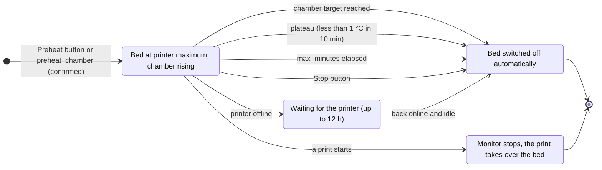
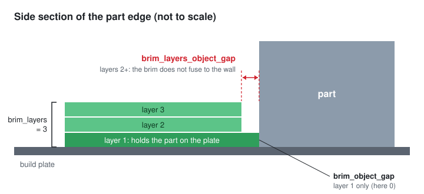
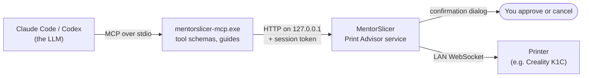

<p align="center">
  
</p>

<h1 align="center">MentorSlicer</h1>

<p align="center"><b>A Creality Print fork with an AI print advisor, chamber preheat and multi-layer brim</b></p>

MentorSlicer is a fork of [Creality Print](https://github.com/CrealityOfficial/CrealityPrint) 7.3, an open source slicer for FDM printers. It adds the **Print Advisor**: a local service that an MCP client (Claude Code, Codex) uses to read the slicing context, diagnose defects, propose profile changes and control a LAN printer, with every change confirmed by the user inside the app. The LLM stays in the client; the app contains only the domain service.

Differences from Creality Print:
- no Creality account, cloud, analytics or update check: the app works offline and prints over the local network (tested with a Creality K1C);
- the Print Advisor (`src/slic3r/GUI/simple/printAdvisor/`, sidecar in `tools/print-advisor-mcp/`) and engine options such as heat soak and multi-layer brim;
- data folder `%APPDATA%\MentorSlicer` (`MentorSlicer.conf`). On its first start MentorSlicer copies the Creality Print 7.3 Alpha data folder once and leaves the original untouched;
- G-code and 3MF files stay compatible with Creality Print (same G-code header and 3MF application tag).

**⬇️ Download for Windows 10/11 (64-bit): [latest release](https://github.com/MirkoUgoliniDev/MentorSlicer/releases/latest)**, a portable zip, nothing to install. See [How to install](#how-to-install) and [How to test the package](#how-to-test-the-package).

MentorSlicer is not affiliated with or endorsed by Creality.

# What's new in MentorSlicer

## 🔥 Chamber preheat
Printers like the K1C have a chamber temperature sensor but no chamber heater: the chamber only warms up from the hot bed. MentorSlicer can preheat the chamber **before** you send the print, so ASA and ABS start in a warm enclosure instead of a cold one.

- **One button on the Device page**: the "Temp camera" card has a **Preriscalda / Stop** button and an optional **°C** field for the chamber target (for example 35 °C). While it runs, the card shows the elapsed time and the target (`Preriscaldo 12:30 → 35°`).
- **From the AI assistant**: the Print Advisor tool `preheat_chamber` does the same, with a confirmation in the app.
- **Safe by design**: the bed is set to the printer maximum (at most 100 °C) and is **switched off automatically** when the target is reached, when the chamber stops rising (plateau), after `max_minutes` (5–120, default 60), or when the Print Advisor is stopped (if recent data shows the printer idle; otherwise you get a notification). If the printer goes offline during a preheat, the bed is switched off as soon as it is reachable and idle again. Only one preheat at a time, and it stops by itself when a print starts.
- **Preflight warning**: for ASA/ABS, the pre-print check warns when the chamber is still cold (below 30 °C) and suggests a preheat and a longer soak.



Related engine options (filament profile): **Heat soak time** and **Heat soak bed temperature** add a soak block before the start G-code (exhaust and side fans off, wait for the bed, dwell), so the chamber can settle after the printer's own preparation.

## 🧱 Multi-layer brim with its own gap
For warping-prone materials a single-layer brim often is not enough. MentorSlicer can repeat the brim on the layers above the first one, and keep those upper brim layers at a **different distance from the part**:

- **Brim layers** (`brim_layers`, process or per object): how many layers the brim has. The first-layer brim is repeated on the following layers, with the flow scaled to the layer height.
- **Brim-object gap on upper brim layers** (`brim_layers_object_gap`): the gap between the brim and the part on layers 2 and above. Layer 1 keeps the normal **Brim-object gap**, so it still holds the part firmly on the plate; a small extra gap on the upper layers (for example 0.1–0.3 mm) stops the repeated brim from fusing to the part wall, so it peels off cleanly. Lines that would come closer than this gap are removed or trimmed, never moved; other objects on the plate are kept clear as well. With a value not larger than the brim-object gap, the upper layers simply copy layer 1.



Tested on a 130 mm ASA part on a Creality K1C (with glue stick on smooth PEI): see the ASA notes in [CLAUDE.md](CLAUDE.md).

## 🤖 Print Advisor for AI assistants
The Print Advisor lets Claude Code or Codex read the slicing context, diagnose defects, propose profile changes and control the printer over the LAN, with every change confirmed inside MentorSlicer. The MCP server ships as `mentorslicer-mcp.exe` next to `MentorSlicer.exe`, so **no Node.js installation is needed**: open **AI Integration → Print Advisor MCP…**, copy the command and press **Enable**. Details in [tools/print-advisor-mcp/README.md](tools/print-advisor-mcp/README.md).



## 📚 Third-party libraries under control
**Help → Third-party libraries** shows for each library what it is used for, the version in use, the latest release and whether it should be updated (or why it is kept on purpose). The **Check for updates** button asks GitHub, GitLab and NuGet only when you press it.

# Main features (inherited from Creality Print)
- Auto calibrations for all printers
- Sandwich(inner-outer-inner) mode - an improved version of the `External perimeters first` mode
- Polyholes conversion support [SuperSlicer Wiki: Polyholes](https://github.com/supermerill/SuperSlicer/wiki/Polyholes)
- Klipper support
- More granular controls


# How to install
**Windows 10/11, 64-bit** (the only platform with a ready-made package):

1. From the [latest release](https://github.com/MirkoUgoliniDev/MentorSlicer/releases/latest) download `MentorSlicer-<version>-win64.zip` and its `.sha256` file.
2. Optional but recommended, verify the download in PowerShell; the two values must match:
   ```powershell
   (Get-FileHash -Algorithm SHA256 .\MentorSlicer-1.0.1-win64.zip).Hash.ToLower()
   Get-Content .\MentorSlicer-1.0.1-win64.zip.sha256
   ```
3. Right-click the zip → **Properties** → tick **Unblock** if present → OK. Then extract it to a folder of your choice, for example `C:\MentorSlicer`. Nothing is installed: the Visual C++ runtime and the MCP server (`mentorslicer-mcp.exe`) are in the folder.
4. Start `MentorSlicer.exe`. The executables are **not code-signed**, so Windows SmartScreen may show *"Windows protected your PC"*: choose **More info → Run anyway**.
5. The app needs the Microsoft Edge WebView2 Runtime, included in Windows 11 and in up-to-date Windows 10. If MentorSlicer reports it missing, install it from [Microsoft](https://go.microsoft.com/fwlink/p/?LinkId=2124703).

Data are stored in `%APPDATA%\MentorSlicer`. On the first start, if a Creality Print 7.3 data folder exists, MentorSlicer copies it once (profiles and settings) and never modifies the original. To update, extract the new zip over the old folder (close MentorSlicer first); to uninstall, delete the folder and, if you want, `%APPDATA%\MentorSlicer`.

**From source**: see [How to compile](#how-to-compile). `tools\publish-stable.ps1` copies a tested build to `C:\MentorSlicer` with a desktop shortcut, and `tools\make-release.ps1` creates the release zip.

**macOS / Linux**: no package is provided. The code inherited from Creality Print still has the macOS and Linux build scripts, but MentorSlicer has been built and tested only on Windows.

# How to test the package

A quick check that takes about ten minutes and does not touch your existing data or printer.

1. **Start with a separate data folder**, so your profiles stay untouched. In PowerShell, from the extracted folder:
   ```powershell
   .\MentorSlicer.exe --datadir "$env:TEMP\MentorSlicer-test"
   ```
   You should see the window **"Welcome to MentorSlicer"** (localized). Choose **Skip printer connection for now**, or **Connect printer via LAN** to check that your printer is found once.
2. **Slice something**: in **Prepare**, pick a printer and filament, add a model (**File → Import**, or right-click the empty plate → **Add testing Primitive**), press **Slice plate** and look at the **Preview**: time and filament usage are shown.
3. **New options**: in the process settings (**Advanced** on), search for *Brim layers* and *Brim-object gap on upper brim layers*; in the filament settings, *Heat soak time*. Set *Brim layers* to 3, slice again and check the brim in the preview.
4. **Print Advisor** (optional, needs Claude Code): open **AI Integration → Print Advisor MCP…**, press **Enable** and copy the command. Since this test uses `--datadir`, the copied command already includes the matching `MENTORSLICER_ADVISOR_DESCRIPTOR`. Run it in a terminal (it replaces an existing `mentorslicer-advisor` registration), start Claude Code and ask *"Read my print context with the Print Advisor"*: Claude should list your printer, filament and process profiles. Afterwards remove the test registration with `claude mcp remove mentorslicer-advisor -s user`, and register again the command shown by a normal start of MentorSlicer.
5. **Third-party libraries**: **Help → Third-party libraries → Check for updates** should complete and show the date of the check.
6. **Clean up**: close MentorSlicer and delete `%TEMP%\MentorSlicer-test`.

If something fails, please open an [issue](https://github.com/MirkoUgoliniDev/MentorSlicer/issues) with the steps, your Windows version and, if available, the log files in `%TEMP%\MentorSlicer-test\MentorSlicer\7.3 Alpha\log` (or `%APPDATA%\MentorSlicer\log` for a normal start).

# Command line slicing

MentorSlicer can run slicing jobs from the command line without opening the normal GUI workflow. Use the `--slice` action with one or more input model/project files.

```console
MentorSlicer.exe --slice 0 --outputdir "C:\output" "C:\models\project.3mf"
```

`--slice` selects which plate to slice:

- `--slice 0`: slice all plates.
- `--slice 1`: slice plate 1.
- `--slice 2`: slice plate 2, and so on.

Useful options:

- `--outputdir <dir>`: directory for generated G-code and CLI result files.
- `--load_settings "<setting1.json;setting2.json>"`: load process/printer settings. This is usually needed when slicing STL/OBJ files that do not already contain project settings.
- `--load_filaments "<filament1.json;filament2.json>"`: load filament settings.
- `--debug <level>`: set log level. `0` is fatal only, `5` is trace.
- `--logfile <file>`: write debug logs to a file.

Examples:

Slice all plates from a 3MF project:

```console
MentorSlicer.exe --slice 0 --outputdir "C:\output" "C:\models\example.3mf"
```

Slice only the first plate and save a log:

```console
MentorSlicer.exe --slice 1 --outputdir "C:\output" --logfile "C:\output\slice.log" "C:\models\example.3mf"
```

Slice an STL with external printer/process and filament presets:

```console
MentorSlicer.exe --slice 0 --outputdir "C:\output" --load_settings "C:\presets\printer.json;C:\presets\process.json" --load_filaments "C:\presets\pla.json" "C:\models\part.stl"
```

Run `MentorSlicer.exe --help` to see the full list of supported command line options.

# How to compile
- Windows 64-bit  
  - Tools needed: Visual Studio 2022 Build Tools (C++ workload), CMake, git.
  - Build the dependencies once with `build_release_vs2022.bat deps`, then build the app with `build_exe_only.bat` (`build\src\Release\MentorSlicer.exe` only) or `build_release_vs2022.bat` (full build with install).
  - See `CLAUDE.md` for the VS Code tasks, the build pitfalls and the Print Advisor notes.

- Mac 64-bit  
  - Tools needed: Xcode, Cmake, git, gettext, libtool, automake, autoconf, texinfo
      - You can install most of them by running `brew install cmake gettext libtool automake autoconf texinfo`
  - run `build_release_macos.sh`
  - To build and debug in XCode:
      - run `XCode.app`
      - open ``build_`arch`/CrealityPrint.xcodeproj``
      - menu bar: Product => Scheme => CrealityPrint
      - menu bar: Product => Scheme => Edit Scheme...
          - Run => Info tab => Build Configuration: `RelWithDebInfo`
          - Run => Options tab => Document Versions: uncheck `Allow debugging when browsing versions`
      - menu bar: Product => Run

- Ubuntu 
  - Dependencies **Will be auto installed with the shell script**: `libmspack-dev libgstreamerd-3-dev libsecret-1-dev libwebkit2gtk-4.0-dev libosmesa6-dev libssl-dev libcurl4-openssl-dev eglexternalplatform-dev libudev-dev libdbus-1-dev extra-cmake-modules libgtk2.0-dev libglew-dev libudev-dev libdbus-1-dev cmake git texinfo`
  - run 'sudo ./BuildLinux.sh -u'
  - run './BuildLinux.sh -dsir'


# Note: 
If you're running Klipper, it's recommended to add the following configuration to your `printer.cfg` file.
```
# Enable object exclusion
[exclude_object]

# Enable arcs support
[gcode_arcs]
resolution: 0.1
```

# Supports
**Creality Print** is an open-source project, and I'm deeply grateful to all my sponsors and backers.   
Their generous support enables me to purchase filaments and other essential 3D printing materials for the project.   
Thank you! :)


## Some background
MentorSlicer is forked from [Creality Print](https://github.com/CrealityOfficial/CrealityPrint) by Creality.  
Creality Print is originally forked from [Orca Slicer](https://github.com/SoftFever/OrcaSlicer) by SoftFever
Orca Slicer is forked from [Bambu Studio](https://github.com/bambulab/BambuStudio) by Bambu
Bambu Studio is forked from [PrusaSlicer](https://github.com/prusa3d/PrusaSlicer) by Prusa Research, which is from [Slic3r](https://github.com/Slic3r/Slic3r) by Alessandro Ranellucci and the RepRap community. 
Creality Print incorporates a lot of features from SuperSlicer by @supermerill
Creality Print's logo is designed by community member Justin Levine(@freejstnalxndr)  


# License
MentorSlicer is licensed under the GNU Affero General Public License, version 3. MentorSlicer is based on Creality Print by Creality.

Creality Print is licensed under the GNU Affero General Public License, version 3. Creality Print is based on Orca Slicer by Orca Slicer.

Orca Slicer is licensed under the GNU Affero General Public License, version 3. Creality Print is based on Bambu Studio by BambuLab.

Bambu Studio is licensed under the GNU Affero General Public License, version 3. Bambu Studio is based on PrusaSlicer by PrusaResearch.

PrusaSlicer is licensed under the GNU Affero General Public License, version 3. PrusaSlicer is owned by Prusa Research. PrusaSlicer is originally based on Slic3r by Alessandro Ranellucci.

Slic3r is licensed under the GNU Affero General Public License, version 3. Slic3r was created by Alessandro Ranellucci with the help of many other contributors.

The GNU Affero General Public License, version 3 ensures that if you use any part of this software in any way (even behind a web server), your software must be released under the same license.

Creality Print includes a pressure advance calibration pattern test adapted from Andrew Ellis' generator, which is licensed under GNU General Public License, version 3. Ellis' generator is itself adapted from a generator developed by Sineos for Marlin, which is licensed under GNU General Public License, version 3.

The bambu networking plugin is based on non-free libraries from Bambulab. It is optional to the Creality Print and provides extended functionalities for Bambulab printer users.

test
